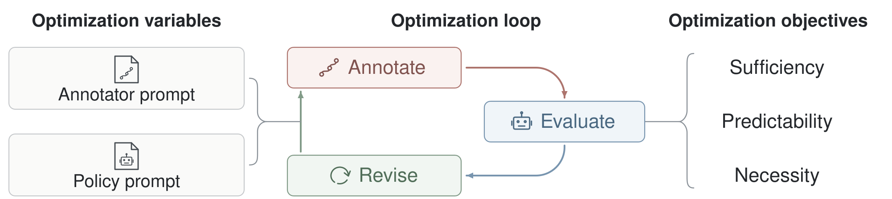

<div align="center">

# MEMI: Reverse-Engineering What Robots Should Remember

[](https://memi-robot.github.io/)
[](https://robomme.github.io/)
[](https://robomme.github.io/leaderboard.html)
[](LICENSE)

</div>

MEMI learns what a robot should remember by reasoning backward from
demonstrations. It treats memory annotations as latent and learns two prompts
of reasoning models jointly. The **annotator prompt** φ says what to remember,
and the **policy prompt** θ says how to update and use that memory. Three
principles guide the search. Memory must be sufficient for the recorded
actions, predictable by the policy as it runs, and free of fields no action
uses. The loop runs offline on recorded demonstrations, and no model weights
change.



Each iteration annotates a fresh minibatch with φ (`annotator.forward`), evaluates the policy under θ
(`policy.forward` and `loss`), and revises both prompts from the failures
(`policy.backward`, `annotator.backward`, `optimizer.step`). MEMI runs as a
high-level planner whose subgoals RoboMME's ground-truth low-level controller
executes (**Plan**, `memi/plan`), and as an end-to-end policy that outputs every
waypoint (**Act**, `memi/act`).

This repository holds the code, the training data, every optimization run
with every LLM answer it received, the optimized prompts and every rollout
log, on the 16 tasks of [RoboMME](https://github.com/RoboMME/robomme_benchmark).

## Results

Mean success (%) over the 16 RoboMME tasks, 50 test episodes per task.
*FullHist* gives the policy the full observation history instead of a memory.
*Init* uses the initial prompts and *MEMI* the optimized ones.

| Policy | FullHist | Init | MEMI |
|---|:---:|:---:|:---:|
| GPT-6 Astra-Plan | 91.3 | 92.4 | **99.4** |
| GPT-6 Luna-Plan | 62.9 | 66.6 | **85.4** |
| Claude Fable-Plan | 85.9 | 88.6 | **97.1** |
| Claude Haiku-Plan | 58.0 | 73.9 | **90.8** |
| GPT-6 Astra-Act | 85.3 | 88.3 | **97.0** |

`python -m memi.report` recomputes these numbers and every other reported
result from the released logs, and checks each one. It needs no API key and no
GPU, and ends with `ALL MATCH`.

## Installation

```bash
git clone --recursive https://github.com/memi-robot/memi.git
cd memi
uv venv --python 3.11 .venv
uv pip install --python .venv/bin/python -e third_party/robomme_benchmark -e ".[sim]"
source .venv/bin/activate
cp .env.example .env    # then set OPENAI_API_KEY, ANTHROPIC_API_KEY or both
```

- The rollouts need an NVIDIA GPU for the RoboMME simulator. The optimization
  needs only the LLM API.
- Act and the offline replay of Act read the
  [RoboMME h5 files](https://huggingface.co/Yinpei/robomme_data_h5). Put them
  in `data/robomme_data_h5` or set `ROBOMME_H5_DIR`.

## Offline checks

```bash
python -m memi.report     # every reported number, ends with ALL MATCH
bash scripts/replay.sh    # every released optimization run, ends with ALL IDENTICAL
```

The replay reruns each released optimization run on its recorded LLM answers
and checks that the code writes the same files. `FAMILY=gpt`, `claude` or
`act` replays one family, and `TASKS=StopCube` one task.

## Reproduce

Each command below makes paid API calls. Everything goes under `OUT`
(`outputs/` by default) in the layout of the release, so
`python -m memi.report --root outputs` reads it.

Roll out one condition with its released prompts.

```bash
WORKERS=8 bash scripts/rollout.sh luna/memi
WORKERS=8 bash scripts/rollout.sh astra_act/memi
TASKS=StopCube EPISODES="0 1 2" bash scripts/rollout.sh haiku/memi   # a quick try
```

Or run the loop yourself, from the initializer to the rollouts.

```bash
bash scripts/init.sh                                    # 1. initial prompts of every task
POLICY=luna bash scripts/optimize.sh                    # 2. five iterations
PROMPTS_FROM=outputs bash scripts/rollout.sh luna/memi  # 3. rollouts of the optimized prompts
```

`PROMPTS_FROM=outputs bash scripts/reproduce_all.sh` runs all three steps for a
whole family, and without `PROMPTS_FROM` it rolls out the released prompts.

| `FAMILY` | `POLICY` | Models |
|---|---|---|
| `gpt` (default) | `astra_plan`, `luna` | GPT-6 Astra runs the initializer, annotator and optimizer. The policy is Astra or Luna. |
| `claude` | `fable`, `haiku` | Claude Fable 5.1 runs the other roles. The policy is Fable or Haiku 5.5. |
| `act` | `astra_act` | GPT-6 Astra runs every role, end to end. |

- A condition is `<policy>/<method>`, with the methods `fullhist`, `init`,
  `memi`, `memi_iteration1` to `memi_iteration4` and `memi_no_<principle>`.
  [`configs/conditions.json`](configs/conditions.json) defines each one.
- `TASKS="StopCube RouteStick"` runs a subset of the tasks, and `ITERATIONS=1`
  fewer iterations.
- `ABLATE=sufficiency`, `predictability` or `necessity` in
  `scripts/optimize.sh` withholds one principle, as in the ablations.
- LLM outputs are not deterministic, so a rerun gives other prompts and other
  episodes. The offline replay reproduces our runs exactly.

## Repository layout

```
memi/
  plan/          Plan: the optimization loop (loop/), its prompts (prompts/), rollouts (rollout/) and data builder (data/)
  act/           Act: the same parts for the end-to-end policy
  llm/           the LLM clients and the list prices
  report.py      every reported number, from the released logs
  replay.py      the offline replay of every released optimization run
  rollout.py     the rollouts of one condition
scripts/         init.sh, optimize.sh, rollout.sh, reproduce_all.sh, replay.sh
configs/         conditions.json, every condition
data/decisions/  the Plan training data
artifacts/       the released optimization runs and their prompts, per family
results/         the released rollout logs, results/<policy>/<method>
third_party/     RoboMME and the Embodied-Astra harness, as git submodules
```

## Citation

```bibtex
@misc{ryu2026memi,
  title        = {MEMI: Reverse-Engineering What Robots Should Remember},
  author       = {Ryu, Sooyoung and Dai, Yinpei and Du, Yilun and Finn, Chelsea and Liu, Yuejiang},
  year         = {2026},
  url          = {https://memi-robot.github.io/}
}
```

## Acknowledgments

The tasks, the low-level controller and the simulator come from
[RoboMME](https://github.com/RoboMME/robomme_benchmark), built on
[ManiSkill](https://github.com/haosulab/ManiSkill). Act adapts the harness of
[Embodied-Astra](https://github.com/jackbjed/embodied-astra-robomme). The
revision step follows [TextGrad](https://github.com/zou-group/textgrad). We
thank OpenAI and Anthropic for providing API credits for this work.

## License

This code is released under the [Apache 2.0 license](LICENSE). `memi/act/`
adapts the MIT-licensed Embodied-Astra harness and keeps its license
(`memi/act/LICENSE`).
